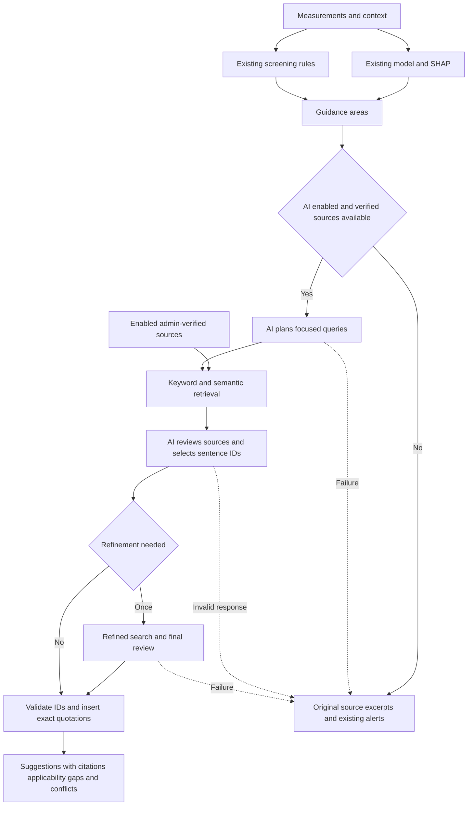
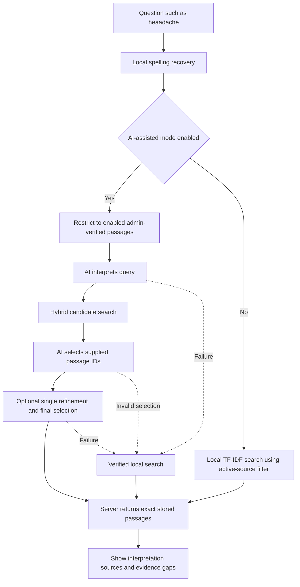

# How AI is used in the project

Gemini supports evidence search and presentation. The supplied Random Forest predicts risk, SHAP explains its output and deterministic rules supply screening flags.

## Assessment guidance flow

Assessment guidance permits at most three generation calls and one refinement, within a 55-second work budget. Embedding failure permits keyword search. Invalid references or provider failure return excerpt-based guidance. Valid IDs do not establish medical correctness or claim support.

## Test retrieval flow

Test retrieval permits at most three generation calls within a 40-second work budget. The server resolves IDs to stored text; no AI-written medical answer is displayed. Missing verified evidence produces a gap. Interpretation, corrections and fallback status are visible.

## Data and limitations

Google receives the query and eligible verified evidence. Assessment guidance also supplies measurements and context. Source embeddings are cached by content and model. Test retrieval does not search the web.

Local spelling recovery uses eligible source vocabulary and similarity matching. It can miss or misinterpret words. Number and simple-negation checks reduce rewrite errors but cannot prove semantic equivalence.

Gemini needs a valid server key and enabled evidence-loop switch. Free Render storage can reset sources and settings; restore them manually before demos. The chatbot is preserved only in Future_Chatbot.md.

Evaluate typo recovery, paraphrases, qualifiers, missing evidence, fabricated IDs and provider failure. Provider mocks establish control flow rather than live availability or clinical accuracy.
